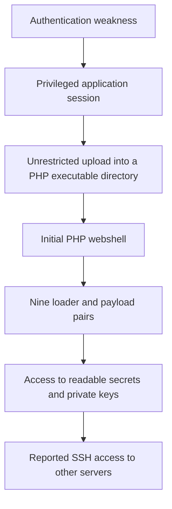

# Real Life Incident Handling

## Webshell compromise across a shared Linux web server

This case study draws on my experience handling a real web application security incident. It presents the investigation from a SOC Tier 2 perspective, covering the attack sequence, webshell behavior, credential exposure, containment decisions, and recovery requirements.

The incident involved a staging server hosting multiple learning-platform websites. An attacker exploited authentication and upload weaknesses, deployed backdoors across nine sites, and collected credentials that could extend access beyond the original host.

**Assessment at the documented checkpoint: Critical severity, with partial containment and unresolved wider exposure.**

Client and institution names, hostnames, addresses, account names, exact operational paths, and raw indicators have been omitted. The detailed incident reports and evidence are retained outside this public case study.

## My experience and the focus of this write-up

My involvement in this incident gave me practical experience with the difficult part of incident handling: deciding what the evidence establishes, how far the compromise may extend, and what must be verified before declaring recovery.

This write-up focuses on:

- Reconstructing an intrusion from application behavior, web logs, and file metadata.
- Explaining a webshell built from a PHP loader and disguised payload.
- Assessing the impact of shared service accounts and readable secrets.
- Distinguishing well-supported findings from reported activity requiring corroboration.
- Prioritizing credential revocation and containment across multiple systems.
- Defining investigation tasks, escalation points, and evidence required for closure.

Completed actions, reported findings, and recommendations are identified separately below. Proposed recovery work is not presented as a completed result.

## Incident overview

| Area | Documented assessment |
| --- | --- |
| Environment | Linux staging server, nginx, PHP-FPM, and multiple learning-platform websites |
| Initial access | Application authentication weakness followed by unrestricted file upload |
| Execution context | Website service account |
| Persistence | Nine PHP loader and payload pairs across nine sites |
| Activity window | Approximately ten calendar days |
| Credential exposure | 108 private-key files, plus reported access to tokens and application secrets |
| Wider access | Reported SSH access to three additional servers with root or sudo privileges |
| Data impact | A database dump was reportedly read; external transfer remained unconfirmed |
| Recorded outcome | Known staging entry routes restricted and most identified malware removed; wider remediation remained incomplete |

The count of private-key files does not establish the number of unique keys or accepting systems. The checkpoint above is historical and does not establish the environment's present status.

## Attack sequence

### Authentication and upload weaknesses

The application trusted identity and role information supplied in a cookie encoded with base64 and JSON, without a signature protecting its integrity. The upload feature accepted unrestricted file types and saved them in a web-accessible directory where PHP could execute.

Together, these defects provided a route from application access to server-side execution. Base64 encoding did not make the cookie trustworthy, and a successful upload became much more dangerous because its destination allowed code execution.

### Expansion across websites

The sites shared a web service account, and application code was writable by that account. This allowed access obtained through one site to affect other sites on the same server.

The rapid creation of nine loader and payload pairs was consistent with automated deployment. File modification times had been backdated, making creation metadata and independent logs important to the reconstruction.

### Credential access and wider exposure

The incident record described collection of private-key files and access to configuration secrets, repository authentication material, and a database dump. It also reported use of stolen keys to access three additional servers.

Those wider-access claims required corroboration from destination authentication logs, key fingerprints, privileged-session records, and host evidence. Production services, source control, CI/CD, databases, and other credential recipients remained part of the exposure assessment.

## How the webshell worked

The backdoor separated its entry point from its main functionality.

| Component | Reported behavior |
| --- | --- |
| Initial PHP webshell | Provided early execution and reportedly installed the persistent backdoors before being deleted |
| Small PHP loader | Used a fake plugin header and obscured function names; read and decoded its companion content |
| Disguised payload | Resembled a font, image, cache, or session file while containing the remote-control functionality |
| Execution process | Decoded content into a temporary file, included it through PHP, then deleted the temporary file |

The reported decoded payload supported directory listing, file reading and modification, deletion, timestamp changes, command execution, and collection of host information. It also had its own authentication mechanism.

Commands travelled in POST request bodies that were absent from the described access logs. Investigators could see request timing and metadata without necessarily seeing the commands executed.

The original entry-file sample was no longer available. The available report did not establish a named malware family or provide a complete protocol analysis. Separate restriction-bypass tools were found, but their presence alone did not prove successful use.

## Evidence assessment

| Finding | Evidence position |
| --- | --- |
| Application entry and nine infected sites | Well supported in the incident record by application logic, HTTP activity, and file metadata |
| Private-key collection | File presence documented; provenance, duplicates, and accepting systems still required investigation |
| Access to three additional servers | Reported through earlier investigation summaries; destination records required for corroboration |
| Database dump read | Reported activity; external transfer not established |
| Production or CI/CD compromise | Credible exposure requiring investigation, not a confirmed outcome |
| Root compromise on the staging host | Not established; negative checks did not prove the host was clean |

Several important claims depended on earlier investigation summaries rather than primary evidence reproduced in the report. I kept that distinction visible instead of giving every finding the same confidence level.

Timezone normalization also mattered: older compressed web logs used UTC while newer logs used local time. HTTP status codes, response sizes, and file timestamps were supporting evidence, not standalone proof of successful execution or failed exploitation.

## Response recorded in the incident

The incident record documented these staging response measures:

- Blocking known entry routes and webshell paths through nginx on selected virtual hosts.
- Removing identified loaders, most payloads, and attacker tooling.
- Changing application ownership and reducing service-account write access.
- Restricting outbound IPv4 connections for the web service account.
- Adding PHP restrictions, temporary-directory controls, and a file-monitoring job.

These controls reduced exposure, but their coverage and verification were incomplete. One payload's deletion remained unconfirmed. Some virtual hosts were outside the blocking coverage, and runtime settings, monitoring execution, and persistence after restart still required checks.

There was no confirmed revocation of all exposed credentials at the recorded checkpoint. The three reportedly accessed servers and several connected services also remained unresolved.

## Investigation and recovery priorities

| Priority | Action | Evidence of completion |
| --- | --- | --- |
| Immediate | Isolate affected systems while preserving essential evidence | Verified isolation, controlled administration, and recorded exceptions |
| Immediate | Map and revoke exposed keys, tokens, passwords, and sessions | Revocation records and controlled checks showing old access rejected |
| Immediate | Assess production equivalents and other credential recipients | Named asset owners, exposure findings, and containment decisions |
| Next | Investigate SSH activity, CI/CD changes, database access, and persistence | Correlated authentication, host, application, and service evidence |
| Before reopening | Rebuild affected hosts and repair authentication and upload defects | Trusted build provenance, remediation tests, and service acceptance |
| Before closure | Validate monitoring and resolve material findings | Working off-host telemetry, tested detections, and documented sign-off |

Replacement credentials should reach trusted systems. Rotating a secret on a host that remains under attacker control can expose the replacement.

Recovery also requires separate site identities, effective filesystem restrictions, controlled internal and external connectivity, and review of all equivalent upload routes. Sensitive-data impact and notification decisions belong with the appropriate incident and legal owners.

## MITRE ATT&CK mapping

These mappings describe behavior in the incident record. They do not attribute the activity to a particular actor and retain the confidence limits above.

| Technique | Relevant behavior |
| --- | --- |
| [T1190 Exploit Public-Facing Application](https://attack.mitre.org/techniques/T1190/) | Authentication and upload weaknesses |
| [T1505.003 Web Shell](https://attack.mitre.org/techniques/T1505/003/) | Persistent PHP loaders and payloads |
| [T1552.004 Private Keys](https://attack.mitre.org/techniques/T1552/004/) | Collection of private-key files |
| [T1021.004 SSH](https://attack.mitre.org/techniques/T1021/004/) | Reported access to additional servers |
| [T1070.006 Timestomp](https://attack.mitre.org/techniques/T1070/006/) | Backdated file modification times |
| [T1005 Data from Local System](https://attack.mitre.org/techniques/T1005/) | Reported reading of locally accessible data |

No exfiltration technique is asserted because external transfer of the database dump was not established.

## Lessons from the incident

1. **A staging compromise can have wider consequences.** Accessible credentials and shared deployment relationships can connect staging to production and other services.
2. **Malware removal is only one part of recovery.** Stolen credentials remain usable until revoked at the systems that accept them.
3. **Shared permissions increase the scope of compromise.** A defect in one application affected nine sites because the service account could write across their code trees.
4. **Evidence quality changes the conclusion.** Missing samples, summary-dependent claims, altered timestamps, and inconsistent timezones require explicit confidence limits.
5. **Configured controls need runtime validation.** Ownership counts and successful configuration checks do not establish effective isolation across every site.
6. **Closure requires positive verification.** Trusted recovery, removed access, resolved findings, and functioning monitoring are stronger criteria than a quiet log or the absence of blocked probes.

## Skills demonstrated in this case study

Incident triage and severity assessment · Web log correlation · Linux file metadata analysis · Application root-cause analysis · Webshell behavior analysis · Credential exposure assessment · MITRE ATT&CK mapping · Containment planning · Evidence handling · SOC escalation and reporting

## Technical references

- [OWASP File Upload Cheat Sheet](https://cheatsheetseries.owasp.org/cheatsheets/File_Upload_Cheat_Sheet.html)
- [PHP configuration directives and security limitations](https://www.php.net/manual/en/ini.core.php)
- [NIST SP 800-61 Revision 3](https://csrc.nist.gov/pubs/sp/800/61/r3/final)

The technical references support the analysis framework. They are not evidence that any specific response action was completed in this incident.
