# SOC automation lab: Wazuh, Sysmon, TheHive, Shuffle

This folder holds a small SOC lab I built on Microsoft Azure. When Mimikatz runs on a Windows
machine, the lab catches it and turns it into an alert in TheHive without any manual steps. Sysmon
logs the process start, and Wazuh fires a level 15 alert mapped to MITRE ATT&CK T1003 (OS Credential
Dumping). Shuffle then pulls the file hash out of the alert, checks it on VirusTotal and creates an
alert in TheHive. The whole chain worked end to end on 26 October 2026. The email notification step
is built but not confirmed yet.

Most of the time went into troubleshooting. I hit more than 20 problems along the way: cloud
networking, Java versions, TLS, agent enrollment, a rule that never saved and broken JSON. Each
problem is written up below with what I saw, what caused it and how I fixed and checked it.

## What is in this folder

| Path | What it is |
|---|---|
| [configs/wazuh/mimikatz_rules.xml](configs/wazuh/mimikatz_rules.xml) | My custom Wazuh rules that detect Mimikatz |
| [configs/wazuh/agent-ossec-sysmon-localfile.xml](configs/wazuh/agent-ossec-sysmon-localfile.xml) | The block that makes the Windows agent read Sysmon events |
| [configs/wazuh/manager-shuffle-integration.xml](configs/wazuh/manager-shuffle-integration.xml) | The Wazuh to Shuffle integration (webhook redacted) |
| [configs/thehive/index-search.conf](configs/thehive/index-search.conf) | How TheHive connects to Elasticsearch 8 over HTTPS (passwords redacted) |
| [images/](images/) | Screenshots from the lab. IPs and passwords are blacked out |

## Architecture

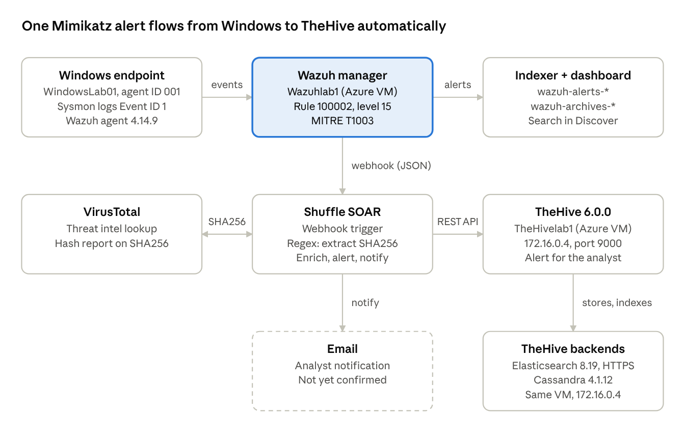

| Component | Where it runs | Version | Job |
|---|---|---|---|
| Sysmon + Wazuh agent | Windows endpoint WindowsLab01 (192.168.54.131) | Agent 4.14.9 | Logs process creation and sends it to Wazuh |
| Wazuh manager, indexer, dashboard | Wazuhlab1, Azure VM (Ubuntu) | 4.x | SIEM: collects events, runs the rules, raises alerts |
| Shuffle | Hosted SOAR | | Runs the response workflow |
| VirusTotal | Public API | v3 | Hash reputation lookup |
| TheHive | TheHivelab1, Azure VM (Ubuntu), 172.16.0.4 | 6.0.0-1 | Alert and case management |
| Elasticsearch | TheHivelab1 | 8.19.23 | TheHive's search index (port 9200, HTTPS) |
| Cassandra | TheHivelab1 | 4.1.12 | TheHive's database (port 9042) |

## Phase 1: Azure and the virtual machines

I used an Azure for Students subscription in the Denmark East region and created two Ubuntu VMs,
TheHivelab1 and Wazuhlab1. Each VM has its own network security group (NSG), which works as its
firewall. I opened SSH (22) on both, TCP 9000 for TheHive's web interface, and 1514/1515 on
Wazuhlab1 so the agent can connect and enroll.

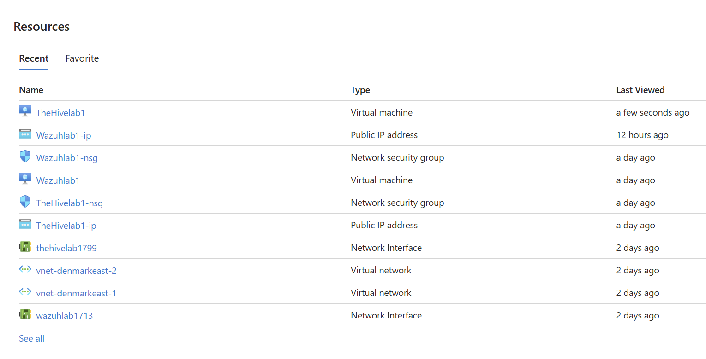

**First problem: TheHive's page timed out.** I had opened `http://<public IP>` and got
`ERR_CONNECTION_TIMED_OUT`. TheHive listens on port 9000, not 80, and Azure blocks inbound traffic
until you add a rule. I had also added my first rule to the wrong NSG. Once the TCP 9000 rule was on
TheHivelab1-nsg, the page loaded.

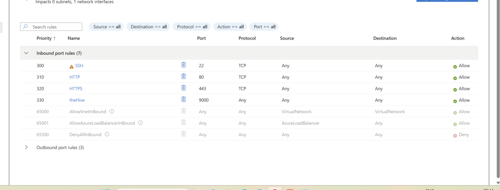

**Public vs private IP.** This caused more trouble than anything else. An Azure VM's operating system
never sees its public IP, because Azure translates that address outside the VM. Services have to bind
to the private IP (172.16.0.4). The public IP is only for reaching the VM from outside.

## Phase 2: Installing the TheHive stack

TheHive needs two backends, so TheHivelab1 runs Elasticsearch, Cassandra and TheHive. It took eight
fixes before Cassandra showed `UN` (Up/Normal) and TheHive created its `thehive` keyspace.

| # | Symptom | Root cause | Fix |
|---|---|---|---|
| 1 | Elasticsearch would not start | `cluster.initial_master_nodes` was defined twice, once with the cluster name instead of the node name | Removed the duplicate. The value must match `node.name` (node-1) |
| 2 | `BindTransportException` in Elasticsearch | `network.host` was the public IP, which the VM does not own | `network.host: 172.16.0.4` |
| 3 | Cassandra showed `active (exited)` and looked fine | Normal for Cassandra's old init wrapper. It says nothing about the real process | Checked with `nodetool status` and `ss -tlnp`. It was actually down |
| 4 | Cassandra: `failed to bind to /<public IP>:7000` | Same public-IP mistake in `cassandra.yaml` | Replaced it with 172.16.0.4 in `listen_address`, `rpc_address`, `seeds` |
| 5 | `nodetool -h <private IP>` refused | JMX only listens on localhost | Ran plain `nodetool status` |
| 6 | Cassandra would not stay running | Cassandra 4.1 was on Java 17. It only supports Java 8 and 11 | Switched to Java 11 with `update-alternatives` |
| 7 | `cqlsh` crashed: `ModuleNotFoundError: six.moves` | Its bundled driver does not work with Python 3.12 | `pipx install cqlsh`. Optional, TheHive does not use cqlsh |
| 8 | TheHive crashed, `UnsupportedClassVersionError` (61 vs 55) | Fix 6 moved the whole system to Java 11, but TheHive 6 needs Java 17 | Java 17 as system default, Cassandra pinned to Java 11 with `JAVA_HOME` in `/etc/default/cassandra` |

Fix 6 is a good example of one fix causing the next problem.

## Phase 3: Getting TheHive to talk to a secured Elasticsearch 8

TheHive started and then died 20 to 65 seconds later, every time. Elasticsearch 8 turns on HTTPS and
login by default, and TheHive was still connecting over plain HTTP with no credentials. The two logs
showed it at the same timestamps:

```
TheHive:        Caused by: org.apache.http.ConnectionClosedException: Connection is closed
Elasticsearch:  received plaintext http traffic on an https channel, closing connection
```

Turning Elasticsearch security off would have been quicker. I fixed the connection instead and kept
TLS and authentication on:

1. Backed up `application.conf`.
2. Created a dedicated Elasticsearch role `thehive_role` (cluster `manage`, `all` on `thehive*`) and a
   `thehive` user, so TheHive does not use the `elastic` superuser. The first login returned 401;
   after a password reset, `_cluster/health` came back `green`.
3. Imported Elasticsearch's self-signed CA into a Java truststore with `keytool`, owned by
   `root:thehive`, mode 640.
4. Added the `elasticsearch { }` block to `index.search` in `application.conf`
   ([redacted copy](configs/thehive/index-search.conf)).

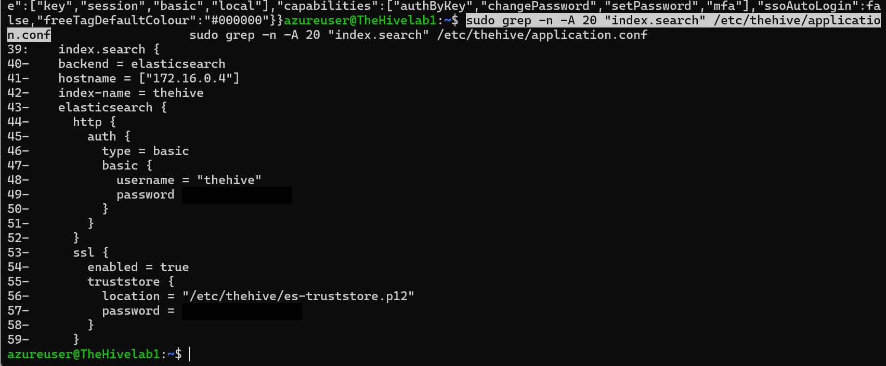

After that, TheHive stayed `active (running)`, listened on port 9000, and `/api/status` returned
version 6.0.0.

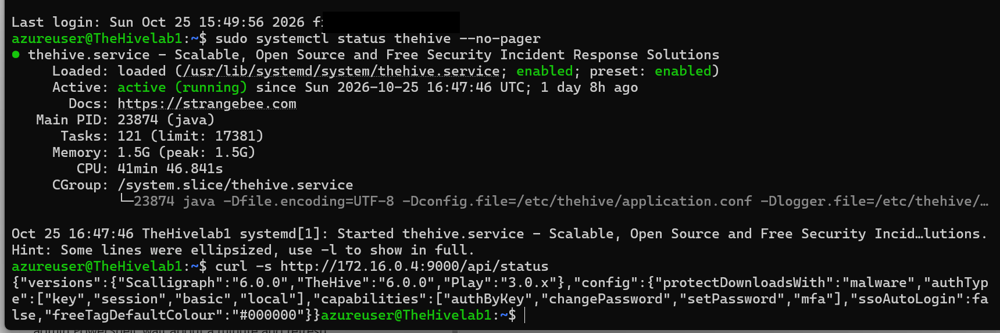

## Phase 4: Wazuh and the Windows agent

I installed Wazuh 4.x on Wazuhlab1 and agent 4.14.9 on Windows. The dashboard kept saying "This
instance has no agents registered", even though the agent service was running.
`Test-NetConnection` on ports 1514 and 1515 succeeded, so the network was fine. The agent's own log
had the answer:

```
ERROR: Invalid agent name: Wazuhlab1. Unable to add agent (from manager)
```

The Windows agent was trying to enroll under the manager VM's name. I gave it a unique name,
WindowsLab01, in the `<enrollment>` section of the agent's `ossec.conf` and restarted it. It
connected and shows as agent 001, Active. I could not prove why the old name was rejected (a name
collision or a stale registration would both explain it), so I left that open rather than guess.

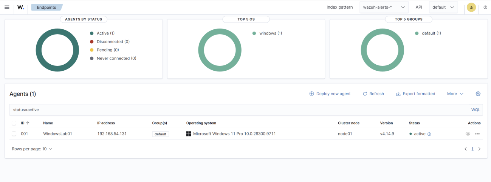

## Phase 5: Sysmon and detecting Mimikatz

1. Turned on full event archiving (`<logall_json>yes</logall_json>`) and made a `wazuh-archives-*`
   index pattern. This makes it possible to tell "no event" from "no alert".
2. Installed Sysmon with a config that logs Event ID 1 (process creation).
3. Made the agent read the Sysmon channel
   ([agent-ossec-sysmon-localfile.xml](configs/wazuh/agent-ossec-sysmon-localfile.xml)).
4. Wrote the rules in [mimikatz_rules.xml](configs/wazuh/mimikatz_rules.xml):
   - **100002** matches `originalFileName` = `mimikatz.exe` on Sysmon Event ID 1. Sysmon reads this
     value from the program's PE header, so renaming the file does not get past it.
   - **100003** matches Mimikatz commands on the command line (`sekurlsa::`, `lsadump::`,
     `privilege::debug`).
   - **100005** matches the original file name on any Sysmon event type.
5. Checked the syntax with `wazuh-analysisd -t`, restarted the manager and ran Mimikatz.

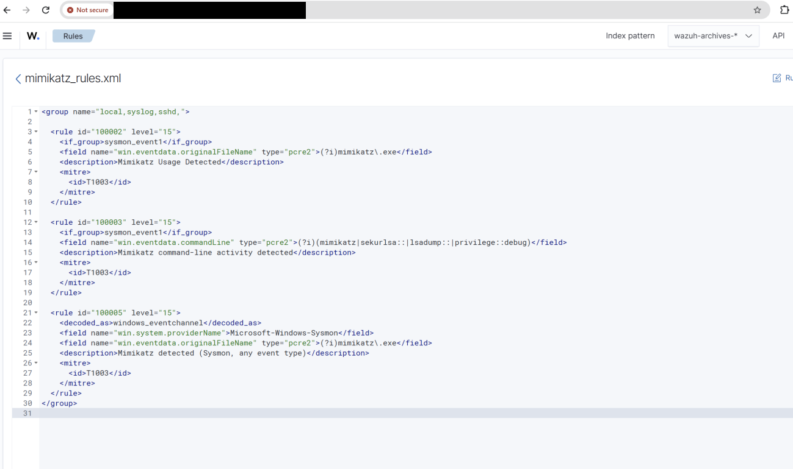

| Problem | Root cause | Fix |
|---|---|---|
| Dashboard error 1905: "File could not be updated, it already exists" | The editor opened `local_rules.xml` as a new-file form, so the rule never saved | Edited the existing file with `nano` on the manager, validated, restarted |
| Mimikatz event in `wazuh-archives-*` but no alert | Collection worked, but the rule had never been saved | Saved it properly. The alert then fired at level 15 |
| Suspected an IP in the rules file was blocking the alert | That IP belongs only to the sample SSH rule 100001 | Nothing to change. Ruled out with evidence |
| Looked at a `net1.exe` event by mistake | Wrong process | Searched `data.win.eventdata.image: *imikatz*` and read the full JSON |

The result: rule 100002, level 15, "Mimikatz Usage Detected", MITRE T1003, from agent WindowsLab01.

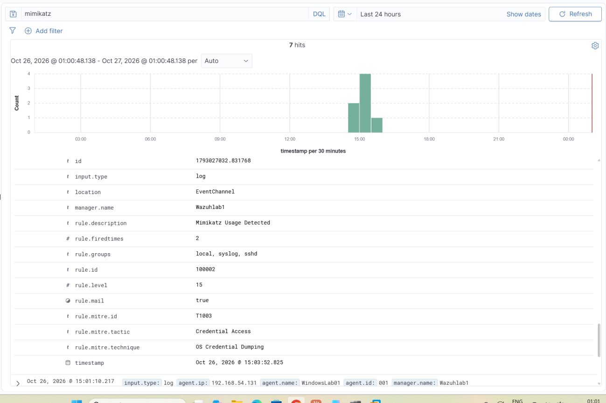

## Phase 6: Connecting Wazuh to Shuffle

Wazuh was generating alerts, but Shuffle never saw one. Checking one layer at a time, I found the
`<integration>` block had `<rule_id>100009</rule_id>`, a rule that does not exist and never fires. I
removed the filter and restarted the manager
([redacted config](configs/wazuh/manager-shuffle-integration.xml)). I also read `shuffle.py`, because
its `filter_msg()` can silently skip alerts. I only called it fixed once a Mimikatz alert actually
started a Shuffle run.

The lesson: a service that starts cleanly and an integration that actually delivers are two
different things.

## Phase 7: The Shuffle workflow

The workflow: webhook trigger, then a regex that pulls the SHA256 out of the Sysmon hashes
(`SHA256=([0-9A-Fa-f]{64})`), then a VirusTotal hash report, then a TheHive alert. An email node
notifies the analyst.

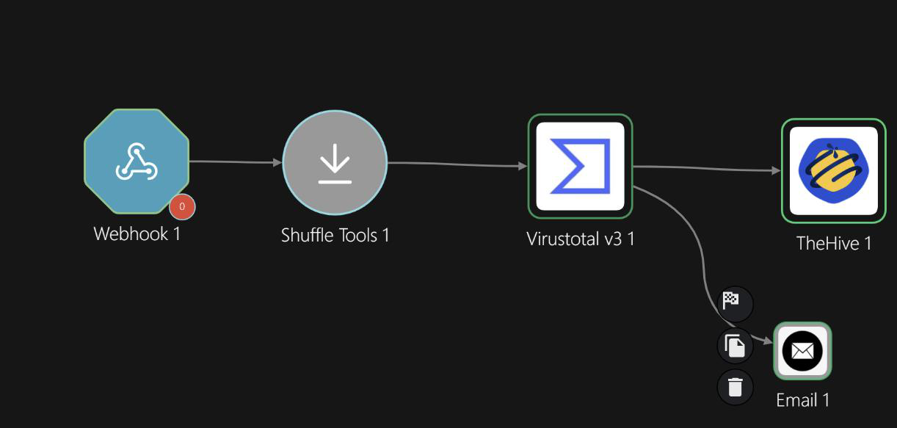

| Problem | Root cause | Fix |
|---|---|---|
| Could not extract the SHA256 | Wrong action and empty input | Regex capture group on `$exec.all_fields.data.win.eventdata.hashes` |
| VirusTotal node had no hash field | Newer Shuffle moves parameters to the Configuration tab | Picked the regex node's `group_0` there |
| TheHive returned 400 "Invalid json" | `severity` was sent as a string | `"severity": 4` |
| Other body mistakes | Unquoted tags, wrong variable syntax, text TLP, fixed `sourceRef` | `"tags": ["T1003"]`, `"tlp": 2`, unique `"sourceRef": "$exec.id"` |

VirusTotal returned a report for the hash:

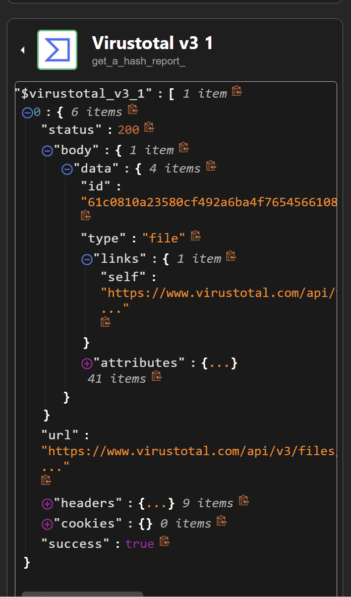

And the alert showed up in TheHive:

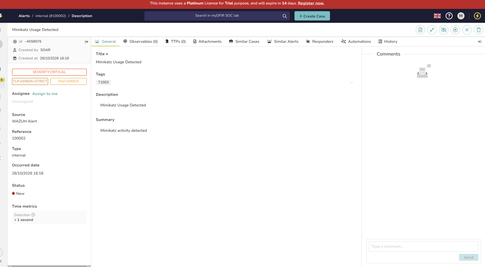

## End-to-end check

| Stage | Result |
|---|---|
| Sysmon Event ID 1 for `mimikatz.exe` in `wazuh-archives-*` | Confirmed |
| Agent WindowsLab01 connected | Active |
| Rule 100002 in `wazuh-alerts-*` | Level 15, T1003 |
| Shuffle workflow started by the alert | Confirmed |
| VirusTotal hash report | Confirmed |
| Alert created in TheHive | Confirmed |
| Email notification | Not confirmed yet |

## What I learned

1. In the cloud, services bind to the private IP. I made this mistake twice, in Elasticsearch and
   then in Cassandra.
2. One green status line proves very little. Check with `nodetool status`, `ss -tlnp`, the logs and
   a real end-to-end test.
3. When a connection fails, read the logs on both ends.
4. Two Java apps on one host need their Java versions set per service.
5. Fixing the configuration takes longer than switching security off, but that is how it would be
   done on a real system.
6. Raw event archives are worth turning on while building detections.
7. Write down what you ruled out, and what you could not prove.

## Next steps

- Fix and confirm the email node.
- Add the VirusTotal detection count and the SHA256 to the TheHive alert.
- Add a Sysmon Event ID 10 rule for access to `lsass.exe`, which catches credential dumping even
  when Mimikatz is renamed or rebuilt.
- Move the rules out of the sample `local,syslog,sshd` group into a Windows group.
- Restrict the NSG rules to my own IP, and add a retention policy for `wazuh-archives-*`.

## Safety note

Mimikatz was only run on an isolated lab VM that I own. Webhook URLs, passwords, API keys and public
IPs are left out of this folder.
